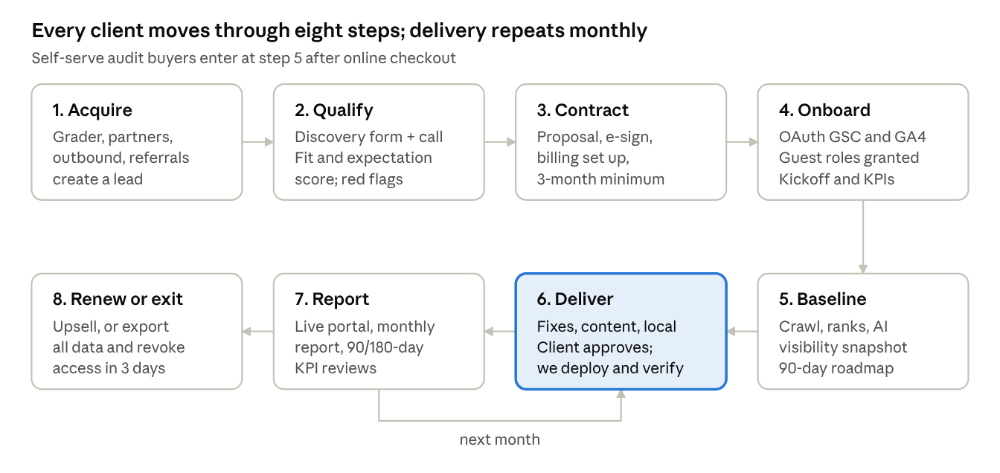
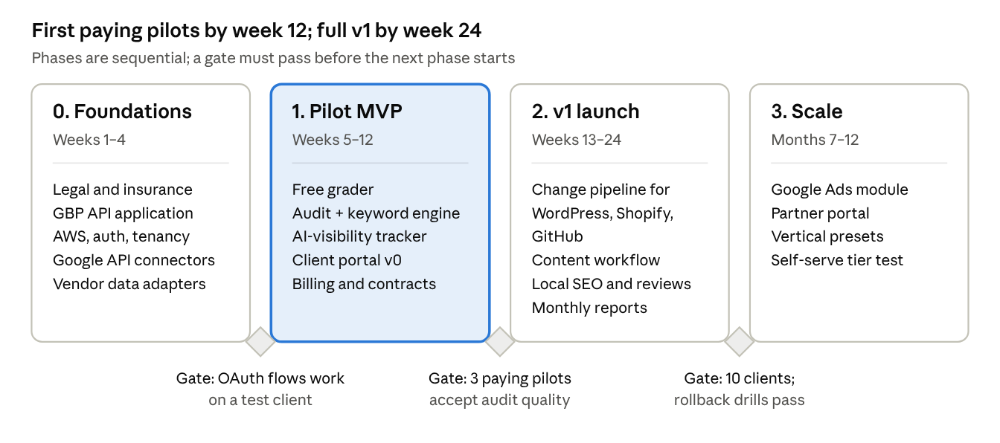

# SEO Platform — Functional Design Document (FDD)

Oct 30, 2026

## 1. Purpose and scope

This FDD defines what the Platform must do to run a software-led SEO business: win clients, onboard them safely, deliver SEO and AI-search visibility work, change their sites under control, and prove results. It is the functional companion to the Technical Design Document (TDD) and is based on the research report *SEO services business landscape* (Oct 2026).

**In scope for v1:** lead capture (free grader), intake, proposals, contracts, billing, client onboarding and access management, audits, keyword and competitor research, local SEO, human-gated content, AI-search visibility tracking, technical implementation on client sites, review management, reporting portal, and the internal operations console.

**Out of scope for v1:** Google Ads management (phase 2), self-serve SaaS tiers, digital PR outreach tooling, migrations and penalty recovery, non-English markets.

**Decisions this design is based on**

| \#  | Decision                  | Choice                                                                                                                                         |
|-----|---------------------------|------------------------------------------------------------------------------------------------------------------------------------------------|
| D1  | Business model            | Hybrid: productized entry offers + monthly retainers, delivered by an internal software platform with a client portal                          |
| D2  | Target market             | No single vertical at launch; US small and mid-sized businesses, English only. Vertical presets are configurable so a niche can be added later |
| D3  | Paid search               | Phase 2. v1 data model and portal reserve space for it                                                                                         |
| D4  | Direct site changes in v1 | WordPress, Shopify, and GitHub-hosted custom code. All other platforms are recommend-only                                                      |
| D5  | Build team                | The founder (software engineer) leads architecture, development and code review                                                          |
| D6  | Stack and hosting         | Python back end, React front end, AWS (with a cost check against cheaper hosts in the TDD)                                                     |
| D7  | Running-cost budget       | Lean: about \$300–800 a month for data, AI models and hosting in the first 6 months                                                            |

**Working assumptions (change if wrong):** the one-off audit can be bought online by card; retainers are sold after a call; the Platform uses an LLM provider through an abstraction layer, with Claude as the default.

## 2. Business context, goals and success metrics

The Platform exists to fill four gaps the research found: affordable AI-search visibility for small and mid-sized businesses, transparency as a product feature, fixes that stay in the client's own site, and (phase 2) SEO and ads managed together. AI answers now appear on about 43–48% of Google searches, but only about 5% of buying-intent searches, so the Platform weights local and commercial intent over blog traffic.

**Positioning promise:** *You own everything. Every change is logged and reversible. We report leads and AI citations, not just rankings. We never guarantee rankings.*

**Business goals for the first 12 months**

| Goal                      | Target                                              | How the Platform measures it                             |
|---------------------------|-----------------------------------------------------|----------------------------------------------------------|
| Paying clients            | 10 by month 6, 25 by month 12                       | Active subscriptions in billing                          |
| Delivery leverage         | 1 person serves 10+ retainer clients                | Clients per active staff member, hours logged per client |
| Client retention          | 80%+ past month 6                                   | Cohort retention at months 3, 6, 12                      |
| Running cost per client   | Under \$80 a month                                  | Usage metering per client (data, AI, hosting share)      |
| Gross margin on retainers | 60%+                                                | Revenue minus direct cost per client                     |
| Grader-to-lead conversion | Measured from launch; target set after 60 days      | Grader runs, emails captured, calls booked               |
| Onboarding time           | Access complete within 5 business days of signature | Access tracker timestamps                                |

Targets are planning assumptions, not research findings. Revisit them at the 90-day review.

## 3. Users, roles and personas

The Platform has three user groups: internal staff, client users, and anonymous visitors. Every person has their own login; shared accounts are not allowed.

| Role              | Who                                                 | Can do                                                                                                                                      | Cannot do                                   |
|-------------------|-----------------------------------------------------|---------------------------------------------------------------------------------------------------------------------------------------------|---------------------------------------------|
| Visitor           | Anyone on the public site                           | Run the free grader, book a call, buy the one-off audit                                                                                     | See any client data                         |
| Client Owner      | The business owner or main contact                  | Approve proposals and contracts, grant platform access, approve site changes, see all reports, export all data, invite client users, cancel | Change Company settings                     |
| Client Member     | Staff the owner invites (e.g., their web developer) | View reports, comment, approve changes if the owner delegates it                                                                            | Billing, contract, cancel                   |
| Admin             | Founder                                             | Everything, including pricing, user management, vendor keys, audit log                                                                      | Bypass client approval on gated changes     |
| Strategist        | SEO lead for an account                             | Run analyses, build roadmaps, create and schedule changes, send reports                                                                     | Change billing or Company settings          |
| Specialist        | Contract writer, editor, local SEO or PR contractor | Work assigned tasks on assigned clients only                                                                                                | See unassigned clients, deploy changes      |
| Reviewer          | Subject-matter expert or editor                     | Approve content, record fact-checks                                                                                                         | Publish without a recorded review           |
| Partner (phase 2) | Web designer or agency referring clients            | See referred leads and commissions                                                                                                          | See client data unless the client grants it |

**Personas the flows are designed for**

- **Local owner (Maria, HVAC company, 8 staff):** wants more calls from Google Maps; no time; distrusts SEO agencies after a bad contract. Buys the Local package.

- **SMB marketing lead (Dev, e-commerce on Shopify, 25 staff):** wants organic revenue and to show up in ChatGPT answers; needs reports for the CEO. Buys the Growth retainer.

- **Client developer (Sam, freelance developer for a law firm's custom site):** must review any code change before it ships. Interacts through GitHub pull requests.

- **Internal strategist (founder at first):** needs one screen per client showing what's due, what's blocked on the client, and what changed.

## 4. Service catalog and packaging

v1 sells five products built from ten services. Prices are starting proposals from the research benchmarks and must be validated with pilot clients; they are stored as configuration, not code.

**Products**

| Product         | Price (proposal)                      | Includes                                                                                                                                                                    | Sold via                |
|-----------------|---------------------------------------|-----------------------------------------------------------------------------------------------------------------------------------------------------------------------------|-------------------------|
| Free Grader     | \$0                                   | Instant score for technical SEO, local presence and AI visibility (sampled); emailed PDF                                                                                    | Public website          |
| Audit + Roadmap | \$1,500–\$5,000 one-off, by site size | Full technical audit, keyword and competitor gap, AI-visibility baseline, prioritized 90-day roadmap with effort and impact                                                 | Online checkout or call |
| Local package   | \$750–\$1,500/mo                      | GBP optimization, citations (pass-through cost), review management, local rank grid, on-page for location pages, AI-visibility monitoring, monthly report                   | Call + contract         |
| Growth retainer | \$2,500–\$5,000/mo                    | Technical fixes implemented, content refreshes and briefs (human-reviewed), keyword strategy, AI-visibility tracking and optimization, reporting, quarterly strategy review | Call + contract         |
| Add-on sprints  | \$4,000–\$15,000 per project          | Implementation sprint, content sprint, earned-links/digital PR campaign (delivered with a partner in v1)                                                                    | Quote                   |

**Services and how each is delivered in v1**

| Service                           | In v1?     | Automation                                                            | Human step                                |
|-----------------------------------|------------|-----------------------------------------------------------------------|-------------------------------------------|
| SEO audit (technical)             | Yes        | Crawl, page speed, Search Console, rule checks, LLM-written narrative | Strategist approves priorities            |
| Keyword and competitor research   | Yes        | Vendor data, LLM clustering and intent labels                         | Strategist picks target clusters          |
| Content creation and optimization | Yes        | Briefs, outlines, first drafts, refresh suggestions                   | Expert review + logged fact-check, always |
| Local SEO                         | Yes        | GBP data and posts via API, citation push via BrightLocal, rank grid  | Strategist approves profile edits         |
| AI-search visibility              | Yes        | Prompt sets sampled across engines, citation share, competitor share  | Strategist interprets and plans work      |
| Technical implementation          | Yes        | Generated fixes (schema, meta, redirects, alt text, internal links)   | Client approval gate; staff review        |
| Reporting and analytics setup     | Yes        | Automated monthly report, live portal, GA4/GSC connection checks      | Strategist writes the summary paragraph   |
| Review management                 | Yes        | Review monitoring, reply drafts, compliant review requests            | Client or staff approves replies          |
| Link building                     | Redesigned | Link reclamation, unlinked-mention discovery                          | Outreach and PR are human; no paid links  |
| Google Ads management             | Phase 2    | —                                                                     | —                                         |

Deferred: digital PR tooling, migrations, penalty recovery, international, programmatic SEO, CRO, YouTube/Amazon.

## 5. Client lifecycle

Steps 6 and 7 repeat each month until renewal. Each step has an owner and an exit condition the ops console tracks:

| Step              | Owner                     | Done when                                                        | Modules               |
|-------------------|---------------------------|------------------------------------------------------------------|-----------------------|
| 1\. Acquire       | Platform / Admin          | Lead record exists with source                                   | M1, M2                |
| 2\. Qualify       | Strategist                | Fit score recorded; go or no-go                                  | M2                    |
| 3\. Contract      | Admin                     | Contract signed, first payment received                          | M3                    |
| 4\. Onboard       | Client Owner + Strategist | All required access Verified; kickoff record complete            | M4                    |
| 5\. Baseline      | Platform + Strategist     | Baseline snapshot stored; roadmap approved by client             | M5, M6, M7, M9        |
| 6\. Deliver       | Strategist + Specialists  | Month's change requests deployed and verified; content published | M7, M8, M10, M12, M13 |
| 7\. Report        | Platform + Strategist     | Monthly report sent; review meeting held at day 90 and 180       | M11                   |
| 8\. Renew or exit | Admin                     | Renewal or upsell recorded, or offboarding checklist complete    | M3, M15               |

## 6. Functional requirements by module

Requirements use MUST (v1 blocker), SHOULD (v1 if time allows) and LATER (phase 2+). IDs are stable so the TDD and tickets can reference them.

### M1. Public grader and lead capture

- **FR-1.1 MUST** Visitor enters a URL, business name and city; the grader returns a score within 90 seconds for sites up to 200 pages (sampled beyond that).

- **FR-1.2 MUST** Score covers technical health, on-page basics, Google Business Profile presence, review count and rating, and AI visibility on 10 sampled prompts.

- **FR-1.3 MUST** Full results require an email; results PDF is emailed and a lead record is created with source attribution (UTM, referrer, partner code).

- **FR-1.4 MUST** Rate-limit by IP and domain; block re-runs of the same domain within 24 hours unless logged in.

- **FR-1.5 SHOULD** Vertical presets (e.g., HVAC, dental) change prompts and scoring weights.

### M2. CRM, intake and qualification

- **FR-2.1 MUST** Lead pipeline with stages: New, Contacted, Discovery booked, Proposal sent, Won, Lost (with reason).

- **FR-2.2 MUST** Discovery questionnaire based on Google's hiring guidance: business model, ideal customer, how customers find them today, revenue per customer, other channels, competitors (3–5), past SEO work, goals, budget, CMS platform.

- **FR-2.3 MUST** Expectation and fit score from the questionnaire, flagging red flags (wants guaranteed \#1 rankings, budget below package floor, recent penalty, timeline under 3 months).

- **FR-2.4 MUST** Outbound email from the Platform includes unsubscribe link, physical address and honors opt-outs within 10 business days (CAN-SPAM).

- **FR-2.5 SHOULD** Booking link integration for discovery calls.

### M3. Proposals, contracts and billing

- **FR-3.1 MUST** Generate a proposal from product templates with the grader or audit findings attached.

- **FR-3.2 MUST** Generate the contract from a versioned template with these default terms: 3-month minimum then month-to-month, 30-day notice, no ranking guarantee, client owns accounts, content, links and tracking history, liability cap of 12 months of fees, mutual confidentiality, DPA exhibit, AI-content disclosure, capped annual price escalator.

- **FR-3.3 MUST** E-signature with signed PDF stored and hashed.

- **FR-3.4 MUST** Card and ACH billing for subscriptions and one-off purchases; invoices; dunning on failed payments; pass-through costs (citations) as line items.

- **FR-3.5 MUST** Self-serve checkout for Audit + Roadmap.

- **FR-3.6 SHOULD** Cancellation flow in the portal that starts offboarding automatically.

### M4. Onboarding and access management

- **FR-4.1 MUST** After signature, create the client workspace and an onboarding checklist tailored to the client's platforms.

- **FR-4.2 MUST** Connect Google Search Console and GA4 via OAuth (read-only scopes by default).

- **FR-4.3 MUST** For each platform (GSC, GA4, GBP, GTM, Shopify, WordPress, GitHub), show step-by-step invite instructions for the minimum role in section 7, and track status: Requested, Granted, Verified, Revoked.

- **FR-4.4 MUST** The Platform never asks for a password in a form, email or chat. Credential fields do not exist.

- **FR-4.5 MUST** Record who granted what, to whom, and when; this record drives offboarding.

- **FR-4.6 MUST** Kickoff record: goals (SMART), KPIs, point of contact, communication cadence, competitor list, 90- and 180-day review dates.

- **FR-4.7 MUST** Baseline snapshot taken at onboarding: crawl, rankings, GSC 16 months, GA4 conversions, AI-visibility baseline, GBP metrics.

### M5. Audit and analysis engine

- **FR-5.1 MUST** Crawl the site (configurable page limit, robots-aware, JavaScript rendering optional) and detect: broken links, redirect chains, status errors, missing or duplicate titles and descriptions, canonical issues, noindex, sitemap and robots problems, thin pages, missing alt text, structured-data errors, hreflang errors, mobile issues.

- **FR-5.2 MUST** Pull Core Web Vitals (field data where available, lab otherwise) for key templates.

- **FR-5.3 MUST** Combine Search Console data to find pages losing clicks, queries ranking 5–20, and index coverage problems (URL Inspection sampled within daily quota).

- **FR-5.4 MUST** Each finding has severity, affected URLs, evidence, estimated effort and impact, and a suggested fix. Every finding cites the data it came from; the LLM never invents a finding.

- **FR-5.5 MUST** Strategist reviews and reorders findings into a roadmap before the client sees it.

- **FR-5.6 MUST** Scheduled re-crawls (weekly for retainers) with diff of new and resolved issues.

### M6. Keyword and competitor research

- **FR-6.1 MUST** Seed keywords from the business, site content, GSC queries and competitor domains.

- **FR-6.2 MUST** Fetch volume, difficulty, SERP features and AI Overview presence; cluster by topic and label intent (transactional, local, commercial, informational).

- **FR-6.3 MUST** Map clusters to existing pages or flag content gaps.

- **FR-6.4 MUST** Rank tracking for selected keywords: weekly by default, daily for Growth; desktop and mobile; local grid for Local clients.

- **FR-6.5 SHOULD** Competitor share-of-voice trend.

### M7. Local SEO

- **FR-7.1 MUST** Connect GBP locations (after Google API approval); read profile data, insights, reviews.

- **FR-7.2 MUST** Profile audit: categories, hours, services, photos, description, Q&A, NAP consistency against the website.

- **FR-7.3 MUST** Propose profile edits and GBP posts; publish only after approval.

- **FR-7.4 MUST** Citation management via BrightLocal: audit, submit, track; costs passed through.

- **FR-7.5 MUST** Local rank grid (e.g., 7×7 points) for up to 10 keywords per location.

- **FR-7.6 MUST** Fallback mode when GBP API access is not yet approved: manual tasks for the Specialist.

### M8. Content workflow

- **FR-8.1 MUST** Content item states: Idea → Brief → Draft → Expert review → Fact-check → Client approval → Scheduled → Published → Monitoring.

- **FR-8.2 MUST** Briefs include target cluster, intent, questions to answer, competitor coverage, required original inputs from the client (quotes, data, photos), and internal links.

- **FR-8.3 MUST** AI can draft; publication is blocked until a named Reviewer records review and a fact-check checklist with sources.

- **FR-8.4 MUST** Every item records which parts were AI-generated, the model used, and who edited.

- **FR-8.5 MUST** Volume guard: alert when a client exceeds a configurable number of new pages per month (default 8) to prevent scaled-content risk.

- **FR-8.6 MUST** Refresh queue: pages with declining clicks get refresh briefs.

- **FR-8.7 MUST** Publish to WordPress or Shopify through M10, or export as HTML/Markdown/Google Doc.

### M9. AI-search visibility

- **FR-9.1 MUST** Per client, a prompt set (default 50, Local 25) built from keyword clusters and customer questions, editable by the Strategist.

- **FR-9.2 MUST** Sample each prompt weekly across: Google AI Overviews, Google AI Mode, ChatGPT, Gemini, Perplexity, Claude, Copilot (engines configurable).

- **FR-9.3 MUST** Record per answer: whether the brand is mentioned, cited (with URL), its position, sentiment, competitors mentioned, and cited sources.

- **FR-9.4 MUST** Metrics: mention rate, citation share vs competitors, sources most cited for the topic, trend with a volatility band (answers vary run to run).

- **FR-9.5 MUST** Opportunity list: prompts where competitors are cited and the client is not, with the cited sources (targets for content, PR, reviews, structured data).

- **FR-9.6 SHOULD** AI crawler access check: robots.txt rules and server logs for GPTBot, Google-Extended, PerplexityBot, ClaudeBot and others.

### M10. Change management and site implementation

- **FR-10.1 MUST** Every site change is a Change Request with: type, target URLs, before value, after value, reason (linked finding), risk level, author, approver, deployment method, status.

- **FR-10.2 MUST** Risk levels: Low (meta, alt text, schema on one page), Medium (content edits, internal links, new pages), High (redirects, robots.txt, canonicals, templates, sitemap, site-wide schema). High always needs client approval and a staging or preview check.

- **FR-10.3 MUST** Client approval in the portal, individually or in batches; Client Owner can set auto-approve for Low-risk types.

- **FR-10.4 MUST** Deployment methods in v1: WordPress (companion plugin with a named user), Shopify (custom app with Admin API), GitHub (pull request from a GitHub App; client merges).

- **FR-10.5 MUST** Pre- and post-deployment crawl of affected URLs; automatic alert if status codes, indexability or titles change unexpectedly.

- **FR-10.6 MUST** One-click rollback for WordPress and Shopify changes; revert pull request for GitHub.

- **FR-10.7 MUST** Change log visible to the client and exportable; changes persist if the client leaves (no script overlays, no remote-loaded code).

- **FR-10.8 MUST** Other platforms (Wix, Webflow, Squarespace, others): recommend-only tickets with copy-paste instructions and code snippets.

- **FR-10.9 MUST** Freeze switch per client that blocks all deployments.

### M11. Reporting and client portal

- **FR-11.1 MUST** Live dashboard: leads and conversions (GA4), organic clicks and impressions (GSC), rankings, AI-visibility share, local metrics, work done this month, changes shipped, items waiting on the client.

- **FR-11.2 MUST** Monthly report generated automatically, with a Strategist-written summary, Google update annotations, and next month's plan.

- **FR-11.3 MUST** 90- and 180-day review reports against kickoff KPIs.

- **FR-11.4 MUST** Full data export (CSV/JSON + PDF reports) at any time and at offboarding, including AI-visibility history and prompt sets.

- **FR-11.5 SHOULD** White-label branding for partner agencies (LATER for partner portal).

### M12. Review management

- **FR-12.1 MUST** Monitor new reviews on Google (and Yelp/Facebook if feasible); alert on 1–3 star reviews.

- **FR-12.2 MUST** Draft replies with AI; post only after approval.

- **FR-12.3 MUST** Review requests go to every customer the client lists, never filtered by sentiment; no incentives tied to rating; consent and send log kept (FTC rule).

### M13. Link reclamation and earned links

- **FR-13.1 MUST** Find lost backlinks and broken inbound links; suggest redirects.

- **FR-13.2 SHOULD** Find unlinked brand mentions and create outreach tasks.

- **FR-13.3 MUST** Block any task type for buying links, link insertions, PBNs or expired domains.

### M14. Operations console (internal)

- **FR-14.1 MUST** Per-client home: health, open tasks, waiting-on-client items, upcoming reviews, spend.

- **FR-14.2 MUST** Task board with assignment, due dates and time logging.

- **FR-14.3 MUST** Agent runs view: every AI agent job with inputs, outputs, cost and approval status.

- **FR-14.4 MUST** Usage and cost metering per client and per vendor; budget alerts.

- **FR-14.5 MUST** Audit log of all staff actions on client data and systems.

### M15. Offboarding

- **FR-15.1 MUST** On cancellation: final report, full export, list of all access to revoke (from M4), confirmation of revocation, removal of GSC verification tokens the Company added, uninstall instructions for the plugin or app (changes stay).

- **FR-15.2 MUST** Delete client personal data within 30 days of contract end unless retention is required; keep billing records.

## 7. Business rules and policies

These rules are enforced by the Platform, not just written in a handbook. Each one maps to a risk from the research.

**BR-1 Tactics policy.** The Platform has no task type, template or agent tool for: buying or selling links, link insertions, PBNs, expired-domain redirects, publishing client content on third-party sites for ranking (site reputation abuse), doorway pages, fake reviews, cloaking, or mass auto-generated pages without unique data.

**BR-2 AI content policy.** AI may draft. A human Reviewer must approve and record a fact-check before anything is published. New pages per client per month are capped by default (8), and raising the cap needs Admin approval with a reason.

**BR-3 No guarantees.** Proposals, reports, ads and the website never promise rankings, placement in AI answers, or Google endorsement. A content linter flags phrases such as "guarantee", "#1 on Google" and "Google partner" in outbound text.

**BR-4 Client owns everything.** The client creates and pays for every account (GSC, GA4, GBP, GTM, Ads, CMS). The Company is a named guest. Access is handed back or revoked within 3 business days of a request.

**BR-5 Minimum access roles**

| Platform                | Company role                                                         | Never                                           |
|-------------------------|----------------------------------------------------------------------|-------------------------------------------------|
| Google Search Console   | Full user (Owner only for migrations, then downgrade)                | Leave verification tokens behind at offboarding |
| GA4                     | Analyst for reporting; Editor only for tracking setup                | Administrator                                   |
| Google Business Profile | Manager                                                              | Primary owner                                   |
| Google Tag Manager      | Edit or Approve; client keeps Publish                                | Sole admin                                      |
| Shopify                 | Collaborator with only needed permissions, or our custom app         | Store owner                                     |
| WordPress               | Named user with a custom "SEO Manager" role used by our plugin       | Shared admin login                              |
| GitHub                  | GitHub App on selected repositories; contents and pull requests only | Direct push to the default branch               |
| Google Ads (phase 2)    | Manager account link without ownership                               | Ownership link                                  |

**BR-6 Change control.** No High-risk change ships without client approval and a pre-deployment check. No remote-loaded code or JavaScript overlays are ever installed on a client site.

**BR-7 Reviews (FTC rule).** Review requests go to all customers, never filtered by sentiment. No incentives tied to positive reviews. No reviews or testimonials written by staff or AI. Case studies from discounted pilot clients disclose the discount.

**BR-8 Outbound email (CAN-SPAM).** Every marketing email has an honest subject, physical address and working unsubscribe; opt-outs are permanent across all sequences.

**BR-9 Data handling.** The Company acts as a data processor for client analytics and CRM data. Client data is never used to train models and is never shared between clients. LLM providers are used with zero-retention or no-training terms where available.

## 8. Non-functional requirements

| ID     | Area                | Requirement                                                                                                                                                    |
|--------|---------------------|----------------------------------------------------------------------------------------------------------------------------------------------------------------|
| NFR-1  | Security            | MFA for every staff and client login; SSO (Google) supported; role-based access per section 3; all client-system tokens encrypted at rest with per-tenant keys |
| NFR-2  | Tenant isolation    | No query, report, agent context or cache can mix data from two clients; automated tests prove it                                                               |
| NFR-3  | Auditability        | Every staff action on client data or client systems is logged with who, what, when and from where; logs kept 2 years                                           |
| NFR-4  | Availability        | Portal 99.5% monthly; scheduled jobs may retry for up to 24 hours; deployments to client sites never run during a declared incident                            |
| NFR-5  | Performance         | Portal pages under 2 seconds at p95; grader result under 90 seconds; monthly reports generated within 1 hour of month end                                      |
| NFR-6  | Cost                | Running cost per client tracked daily; hard monthly caps per vendor and per client, with alerts at 80%                                                         |
| NFR-7  | Scale (v1)          | 50 clients, 25,000 tracked keywords, 5,000 AI-visibility prompts a week, crawls up to 50,000 URLs per site                                                     |
| NFR-8  | Vendor independence | Every external data source sits behind an internal interface so a vendor can be replaced without changing modules                                              |
| NFR-9  | Privacy             | Act as processor under a DPA; data export and deletion on request within 30 days; US data residency                                                            |
| NFR-10 | Accessibility       | Portal and grader meet WCAG 2.2 AA                                                                                                                             |
| NFR-11 | Explainability      | Every number in a report links to its source and date; every AI-written finding links to its evidence                                                          |
| NFR-12 | Safety of changes   | Rollback available for every v1 deployment method; a failed post-deployment check alerts within 15 minutes                                                     |

## 9. Phased roadmap

Durations assume a small engineering team led by the founder working part- to full-time; they are planning estimates. During Phase 1, site changes for pilots are made by hand through the client's CMS and logged, so pilots can start before the change pipeline exists.

## 10. Assumptions, risks and open items

**Key risks and how this design responds**

| Risk                                                 | Response in this design                                                                                 |
|------------------------------------------------------|---------------------------------------------------------------------------------------------------------|
| Clicks shrink under AI answers, so clients doubt ROI | Reports lead with leads, conversions and AI citations (M9, M11); focus on local and buying intent       |
| Google penalizes automated tactics                   | Tactics policy and content gates enforced in software (BR-1, BR-2, FR-8.5)                              |
| Early churn from unrealistic expectations            | Fit scoring at intake (FR-2.3), 90/180-day reviews (FR-11.3), live portal                               |
| A bad deployment hurts a client's rankings           | Risk levels, approvals, crawl checks, rollback, freeze switch (M10)                                     |
| Credential compromise exposes many clients           | No passwords collected, OAuth and app tokens only, MFA, per-tenant encryption, audit log (NFR-1, NFR-3) |
| GBP API approval is delayed or denied                | Manual fallback mode (FR-7.6); apply on day one                                                         |
| GEO tactics are unproven and AI answers vary         | Sell measurement and work performed, show volatility bands, no placement promises (FR-9.4, BR-3)        |
| Without a niche, marketing is diffuse                | Vertical presets (FR-1.5) let the business specialize later without rework                              |
| Vendor prices or terms change                        | Data sources behind interfaces (NFR-8); cost caps (NFR-6)                                               |

**Open items**

- [ ] Validate package prices with at least 3 prospective clients before launch.

- [ ] Have a lawyer review the contract and DPA templates (including state auto-renewal and CCPA service-provider terms).

- [ ] Apply for Google Business Profile API access.

- [ ] Confirm Google's current spam-policy and AI-content guidance directly on Google Search Central.

- [ ] Test whether major AI crawlers render JavaScript (affects how fixes must be shipped).

- [ ] Choose a company name and brand.

- [ ] Phase 2 research: Google Ads fee models, Ads API developer token, Google Partner requirements.

- [ ] Buy E&O and cyber insurance before the first client site change.
