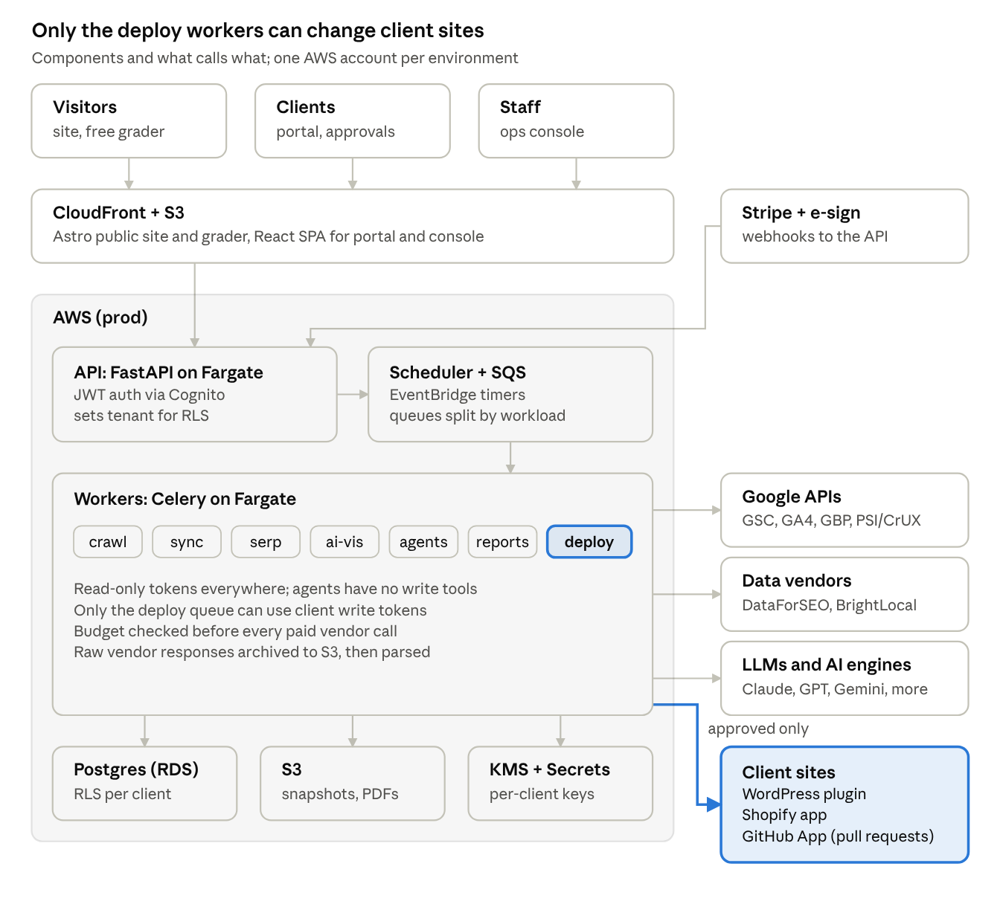
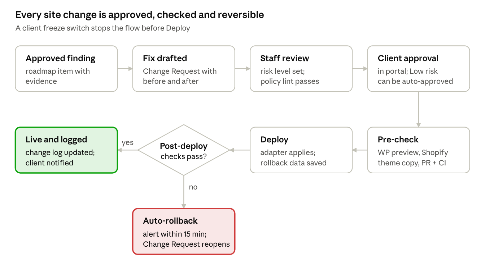

# SEO Platform — Technical Design Document (TDD)

Oct 30, 2026

## 1. Summary and design principles

The Platform is a Python (FastAPI) modular monolith with background workers, a React portal, Postgres as the system of record, and S3 for bulk artifacts, all on AWS. It rents commodity SEO data through APIs and builds the workflow, evidence, approval and change-control layer itself. It implements the requirements in the companion **Functional Design Document (FDD)**; requirement IDs (FR-x.y, BR-x, NFR-x) refer to it.

**Design principles**

1.  **Modular monolith first.** One deployable API and one worker image, split into modules with clear interfaces. Splitting into services comes only when load demands it. This keeps cost and cognitive load low for a small team.

2.  **Evidence before narrative.** Every finding, metric and recommendation is stored as structured data with its source and timestamp before an LLM writes any prose about it (NFR-11).

3.  **Humans gate the world-changing actions.** Agents can read, analyze and propose. Only the deployment service can change a client site, and only for an approved Change Request (BR-6).

4.  **Tenant isolation is enforced by the database**, not by convention (NFR-2).

5.  **Vendors behind ports.** Each data source implements an internal interface; swapping DataForSEO for another vendor touches one adapter (NFR-8).

6.  **Metered by default.** Every external call records cost against a client and a vendor so the Platform can enforce budgets (NFR-6).

7.  **Boring, well-documented technology.** Mainstream frameworks with strong typing and many examples are easier to hire for, review and maintain.

## 2. Architecture



The API and all workers share one codebase and one Postgres database. Users reach the Platform only through CloudFront and the API; workers do all external calls on schedules or events. The deploy queue is the single path to client sites, and it runs only for an approved Change Request.

## 3. Tech stack

| Layer                      | Choice                                                                                                      | Why                                                                    |
|----------------------------|-------------------------------------------------------------------------------------------------------------|------------------------------------------------------------------------|
| API                        | Python 3.12, FastAPI, Pydantic v2                                                                           | Typed request and response models; OpenAPI generated for the front end |
| ORM and migrations         | SQLAlchemy 2.x, Alembic                                                                                     | Mature; works with Postgres row-level security                         |
| Background jobs            | Celery with Amazon SQS broker; Celery Beat replaced by EventBridge Scheduler                                | No Redis to run; SQS costs pennies at this volume                      |
| Workflows with human waits | State machines stored in Postgres (change_request.status, content_item.status) advanced by events           | Approvals can take days; no long-running workers                       |
| Crawler                    | Async httpx + selectolax for HTML; Playwright (Chromium) for sampled JavaScript rendering                   | Fast and cheap for static HTML; real rendering only where needed       |
| Database                   | PostgreSQL 16 on Amazon RDS, with pgvector and monthly partitioned tables for rank and AI observations      | One store for relational, time-series and embeddings at v1 scale       |
| Object storage             | Amazon S3 (crawl snapshots, raw API responses, PDFs, exports)                                               | Cheap; lifecycle rules move old data to Infrequent Access              |
| Portal and console         | React 18 + TypeScript, Vite, TanStack Query and Router, Tailwind + shadcn/ui, client generated from OpenAPI | One SPA with role-based routes for clients and staff                   |
| Public site and grader     | Astro (static) with React islands for the grader form                                                       | Our own site must rank; static HTML is fast and crawlable              |
| Auth                       | Amazon Cognito user pools (MFA, Google sign-in), JWTs verified by the API                                   | Managed MFA and federation; low cost at v1 user counts                 |
| Payments                   | Stripe Billing, Checkout, ACH, Customer Portal                                                              | Subscriptions, one-off audits and pass-through line items              |
| E-signature                | Documenso (open source, self-hosted) or Dropbox Sign API                                                    | Decide in Phase 1; both have APIs and webhooks                         |
| Email                      | Amazon SES for transactional; separate domain and tool for sales outreach                                   | Protects product email deliverability                                  |
| PDF reports                | WeasyPrint from HTML templates                                                                              | Same templates as the portal views                                     |
| LLM access                 | Thin internal llm port with provider adapters; Claude as default, OpenAI and Gemini adapters                | Swap models per task; also needed to sample AI engines                 |
| Infrastructure as code     | AWS CDK (Python)                                                                                            | Same language as the back end                                          |
| CI/CD                      | GitHub Actions; images in Amazon ECR                                                                        | Free tier covers early use                                             |
| Client-side components     | WordPress plugin (PHP 8.1+), Shopify app (Python back end + Shopify Admin GraphQL), GitHub App              | Required for direct changes (D4)                                       |

Python typing is enforced with mypy --strict on core modules and ruff; the front end uses TypeScript strict mode. Typed boundaries are the main defense against subtle integration errors.

## 4. Repository layout and module boundaries

One monorepo. Each back-end module owns its tables, exposes a Python service interface, and never imports another module's internals. Cross-module calls go through those interfaces or through domain events.

```text
seo-platform/
  backend/
    app/
      core/          # config, db session + RLS, auth, tenancy, metering, audit log, events
      ports/         # interfaces: SerpData, KeywordData, BacklinkData, LLM, AIEngine, Citations, Storage
      adapters/      # dataforseo/, google_gsc/, google_ga4/, google_gbp/, psi_crux/, brightlocal/,
                     # anthropic/, openai/, gemini/, perplexity/, stripe/, ses/, esign/
      modules/
        leads/         # M1 grader, M2 CRM + intake
        commerce/      # M3 proposals, contracts, billing
        onboarding/    # M4 access grants, connections, kickoff, baseline
        audit/         # M5 crawler, rules engine, findings, roadmap
        keywords/      # M6 research, clustering, rank tracking
        local/         # M7 GBP, citations, rank grid
        content/       # M8 briefs, drafts, reviews, publishing
        ai_visibility/ # M9 prompt sets, sampling, citation metrics
        changes/       # M10 change requests, approvals, deployers, verification, rollback
        reporting/     # M11 dashboards, monthly reports, exports
        reviews/       # M12 review monitoring, replies, requests
        links/         # M13 reclamation, mentions
        ops/           # M14 tasks, analysis job runs, usage, M15 offboarding
      agents/        # analysis job definitions, tool registry, prompt templates, eval sets
      api/           # FastAPI routers per module, OpenAPI
      workers/       # Celery task entry points per module
    migrations/
    tests/
  frontend/          # React SPA: portal (client) + console (staff)
  site/              # Astro public site + grader
  integrations/
    wordpress-plugin/  # PHP plugin
    shopify-app/       # Shopify app config + extension (back end lives in backend/)
    github-app/        # app manifest; logic lives in backend/adapters/github/
  infra/             # AWS CDK stacks
  docs/              # ADRs, runbooks, this TDD's living copy
  CONTRIBUTING.md    # contributor conventions (section 13)
```

## 5. Data model

Every client-owned row carries client_id; Postgres row-level security (RLS) policies compare it with the session variable app.client_id, which the API sets per request from the authenticated user's membership. Staff with multi-client access get a session per client, never a bypass. Only migrations and the billing reconciler run as a role that skips RLS.

**Core entities (v1)**

| Module        | Entity                                    | Key fields                                                                                                                | Notes                                         |
|---------------|-------------------------------------------|---------------------------------------------------------------------------------------------------------------------------|-----------------------------------------------|
| core          | user, membership                          | cognito_sub, email; user_id, client_id, role                                                                              | Role per client (FDD section 3)               |
| core          | client                                    | name, status, plan, vertical_preset, freeze_deploys                                                                       | The tenant                                    |
| core          | audit_event                               | actor, action, target, client_id, ip, at                                                                                  | Append-only; NFR-3                            |
| core          | usage_event                               | client_id, vendor, unit, qty, cost_usd, at                                                                                | Feeds budgets and margin reports              |
| leads         | lead, grader_run                          | source, utm, score_json, email                                                                                            | Pre-tenant; no client_id until won            |
| commerce      | proposal, contract, subscription          | template_version, signed_pdf_s3, sha256; stripe ids                                                                       | Contract terms versioned                      |
| onboarding    | site, location                            | domain, cms, cms_version; GBP location id, NAP                                                                            | A client can have several sites and locations |
| onboarding    | connection                                | provider, scopes, encrypted_token, status                                                                                 | OAuth and app tokens, envelope-encrypted      |
| onboarding    | access_grant                              | platform, role, granted_by, requested_at, verified_at, revoked_at                                                         | Drives offboarding (FR-4.5)                   |
| audit         | crawl, page_snapshot                      | config, started_at; url, status, title, meta, canonical, hash, s3_key                                                     | Raw HTML in S3                                |
| audit         | finding                                   | rule_id, severity, urls, evidence_json, effort, impact, status                                                            | Evidence required (FR-5.4)                    |
| audit         | roadmap_item                              | finding_id, priority, due, approved_by                                                                                    | Strategist-approved                           |
| keywords      | keyword, cluster, rank_observation        | text, volume, intent, embedding; position, url, serp_features, ai_overview, at                                            | Observations partitioned monthly              |
| ai_visibility | prompt, ai_observation, ai_citation       | text, cluster_id; engine, model, run_at, answer_s3, mentioned, position, sentiment; url, domain, is_client, is_competitor | Partitioned monthly                           |
| content       | content_item, content_review              | status, brief_json, draft_s3, ai_provenance_json; reviewer_id, checklist_json, sources                                    | FR-8.3, FR-8.4                                |
| changes       | change_request                            | type, risk, target, before, after, finding_id, status, approved_by                                                        | State machine (section 9)                     |
| changes       | deployment, verification                  | adapter, external_ref (PR url, WP revision), rollback_ref; checks_json, passed                                            | Rollback data stored with each deployment     |
| local         | gbp_snapshot, citation_listing, grid_scan | metrics_json; directory, status; point, keyword, position                                                                 |                                               |
| reviews       | review, review_reply, review_request      | platform, rating, text; draft, approved_by; recipient, sent_at, consent                                                   | FTC log (BR-7)                                |
| reporting     | report                                    | period, pdf_s3, summary, sent_at                                                                                          |                                               |
| ops           | task, agent_run                           | assignee, due, time_logged; agent, model, input_ref, output_ref, tokens, cost, status                                     | FR-14.3                                       |

All timestamps are UTC timestamptz. Soft delete is used for client-visible records. Hard delete runs at offboarding plus 30 days (FR-15.2).

## 6. External integrations

Each integration is an adapter behind a port in app/ports. Adapters handle auth, retries with backoff, quota accounting, cost metering and raw-response archiving to S3. Costs marked "verify" were not confirmed in the research and must be checked before the budget is finalized.

| Integration                                                                            | Used for                                                                                    | Auth                                | Limits and cost                                                                         | FR          |
|----------------------------------------------------------------------------------------|---------------------------------------------------------------------------------------------|-------------------------------------|-----------------------------------------------------------------------------------------|-------------|
| [Google Search Console API](https://developers.google.cn/webmaster-tools/limits?hl=it) | Clicks, impressions, queries, index status                                                  | OAuth, webmasters.readonly          | Free; 1,200 Search Analytics queries/min/site; URL Inspection 2,000/day/site, so sample | 4.2, 5.3    |
| Google Analytics 4 Data API                                                            | Conversions, landing-page sessions                                                          | OAuth, analytics.readonly           | Free; quota tokens per property (verify)                                                | 4.2, 11.1   |
| PageSpeed Insights + CrUX API                                                          | Core Web Vitals                                                                             | API key                             | Free (verify current quotas)                                                            | 5.2         |
| [Google Business Profile APIs](https://developers.google.com/my-business/content/faq)  | Profile data, posts, reviews, insights                                                      | OAuth as a Manager on each profile  | Free, but access needs an application; review up to 14 days                             | M7, M12     |
| [DataForSEO](https://dataforseo.com/pricing/serp/serp-api)                             | SERPs and rank tracking, keyword data, backlinks, AI Overview data, LLM mentions            | API login                           | Pay-as-you-go; SERPs from about \$0.0006 each in standard queue                         | M6, M9, M13 |
| [BrightLocal](https://www.brightlocal.com/local-data-aggregators)                      | Citation audits and submissions                                                             | API key                             | About \$2–\$3.20 per citation + \$120/yr aggregator renewal; passed through to client   | 7.4         |
| Anthropic, OpenAI, Google Gemini APIs                                                  | Our agents (Claude default); sampling ChatGPT/Gemini/Claude answers with web search enabled | API keys                            | Per-token; capped per client (section 11)                                               | M5–M12      |
| Perplexity Sonar API                                                                   | Sampling Perplexity answers with citations                                                  | API key                             | Per request (verify)                                                                    | 9.2         |
| AI Overviews / AI Mode / Copilot                                                       | Sampling Google's AI answers                                                                | Via DataForSEO or SerpApi endpoints | Per request                                                                             | 9.2         |
| Stripe                                                                                 | Subscriptions, Checkout, invoices, ACH, webhooks                                            | Secret key + webhook signing secret | 2.9% + 30¢ per card payment (verify)                                                    | M3          |
| E-sign provider                                                                        | Contract signature + webhook                                                                | API key                             | Depends on choice                                                                       | 3.3         |
| Amazon SES                                                                             | Transactional email, reports                                                                | IAM                                 | About \$0.10 per 1,000 emails (verify)                                                  | M2, M11     |
| WordPress (our plugin)                                                                 | Read and write SEO fields, redirects, schema                                                | Signed key pair per site            | —                                                                                       | M10         |
| Shopify Admin GraphQL (our app)                                                        | SEO fields, redirects, alt text, metafields, theme copies                                   | OAuth app install                   | Rate-limited by query cost (verify for our scopes)                                      | M10         |
| GitHub (our GitHub App)                                                                | Branches, commits, pull requests                                                            | App JWT + installation tokens       | 5,000+ requests/hour per installation (verify)                                          | M10         |
| Bing Webmaster API                                                                     | Optional Bing data                                                                          | API key                             | Free (verify)                                                                           | SHOULD      |

**Important caveat on AI-engine sampling:** API answers can differ from what a logged-in consumer sees in ChatGPT or Gemini (personalization, model version, search settings). Reports therefore label each engine with the method used, and the Platform stores the model name and settings for every observation.

## 7. AI agent layer and guardrails

Agents are bounded jobs, not free-roaming assistants: each has a fixed input contract, an allowlist of read-only tools, a Pydantic output schema, and a human checkpoint before anything leaves the Platform.

| Agent              | Input                                               | Tools (read-only)                        | Output                                            | Human checkpoint                          |
|--------------------|-----------------------------------------------------|------------------------------------------|---------------------------------------------------|-------------------------------------------|
| Audit Analyst      | Findings from the rules engine, GSC trends          | Query findings, page snapshots, GSC data | Prioritized roadmap draft with rationale per item | Strategist approves roadmap               |
| Keyword Strategist | Seeds, vendor keyword data                          | Keyword and SERP data                    | Clusters, intent labels, page mapping             | Strategist picks targets                  |
| Brief Writer       | Cluster, competitor pages, AI answers for the topic | SERP data, AI observations, site pages   | Content brief with required client inputs         | Strategist edits                          |
| Draft Writer       | Approved brief, client inputs                       | Brief, site style guide                  | Draft with provenance markers                     | Reviewer + fact-check (FR-8.3)            |
| Fix Generator      | Approved finding, site adapter context              | Page snapshot, CMS field read, repo read | Change Request(s) with before/after or code patch | Staff review; client approval by risk     |
| Visibility Analyst | AI observations and citations                       | Observation queries                      | Opportunity list and explanations                 | Strategist                                |
| Report Writer      | Month's metrics, changes, tasks                     | Reporting queries                        | Draft summary paragraph                           | Strategist edits and sends                |
| Review Responder   | New review, business facts                          | Review, GBP profile                      | Reply draft                                       | Client or staff approves                  |
| Grader Summarizer  | Grader scores                                       | Grader results only                      | Plain-language summary                            | None (templated, no claims beyond scores) |

**Guardrails**

- **No write tools.** No agent can call a deployer, send email, publish content or charge money. Those are separate services triggered only by an approved state transition (BR-6).

- **Untrusted content stays data.** Crawled pages, reviews, competitor content and AI answers are wrapped and marked as untrusted in prompts. Agents that read them cannot take actions, which limits prompt-injection damage to a bad draft that a human reviews.

- **Grounding check.** Every claim in an output must reference an evidence id (finding, observation, page). A validator rejects outputs citing ids that do not exist, then retries once.

- **Policy linter.** Outputs pass a rules check for BR-1 and BR-3 phrases (guarantees, paid links, doorway pages) before a human sees them.

- **Model routing.** Small, cheap models for classification and clustering; larger models for analysis and writing. Set per agent in config, not code.

- **Evaluations.** Each agent has a fixed eval set (20–50 cases) in agents/evals; prompt or model changes must not lower the score. Strategist edits to agent outputs are stored and periodically added to the eval sets.

- **Logging and cost.** Every run writes an agent_run row with prompt template version, model, tokens, cost, latency and outcome (accepted, edited, rejected).

- **Data terms.** Use provider settings that exclude API data from training, and zero-retention options where available (BR-9).

## 8. Jobs, scheduling and data pipelines

EventBridge Scheduler puts messages on SQS queues; Celery workers consume them. Queues are split by workload so a large crawl cannot delay a client approval email.

| Queue         | Jobs                                                  | Concurrency                                                       | Schedule                         |
|---------------|-------------------------------------------------------|-------------------------------------------------------------------|----------------------------------|
| interactive   | Grader runs, approval notifications, webhook handling | High, short timeouts (90 s)                                       | On demand                        |
| crawl         | Site crawls, rendered samples, pre/post-deploy checks | Per-domain politeness: 2 requests/s default, robots.txt respected | Weekly for retainers; on demand  |
| sync          | GSC, GA4, GBP, PSI pulls; Stripe reconciliation       | Rate-limited per provider                                         | Daily at off-peak                |
| serp          | Rank tracking, local grids, AI Overview checks        | Batched to vendor standard queue (cheaper)                        | Weekly default, daily for Growth |
| ai_visibility | Prompt sampling across engines                        | Batched per engine, jittered                                      | Weekly per client                |
| agents        | All agent runs                                        | Capped by per-client daily AI budget                              | Event-driven                     |
| deploy        | Deployments, rollbacks                                | One at a time per site                                            | Only after approval              |
| reports       | Monthly reports, exports                              | Low                                                               | 1st of month, 02:00 client time  |

**Job rules**

- Every job is idempotent with an idempotency key (client_id, job type, period), so retries never double-charge vendors or double-deploy.

- Jobs check the client's budget before calling a paid vendor; over-budget jobs pause and alert the Admin (NFR-6).

- Raw vendor responses are written to S3 first, then parsed into tables, so parsing bugs can be fixed and replayed without paying again.

- Failed jobs retry with exponential backoff up to 24 hours, then go to a dead-letter queue visible in the ops console.

- AI sampling runs each prompt once per engine per week by default, and up to 3 times when the Strategist enables the variance mode, to estimate the volatility band (FR-9.4).

## 9. Client-site change pipeline



The pipeline is a Postgres state machine on change_request: draft → in_review → awaiting_client → approved → prechecked → deploying → verifying → live \| rolled_back \| failed. Transitions are only made by the service that owns them, and each one writes an audit_event. High-risk changes (FDD FR-10.2) always need client approval and a successful pre-check.

**Deployment adapters (v1)**

| Adapter          | How it writes                                                             | What it can change                                                                                                                           | Pre-check                                                                         | Rollback                                                                      | Persistence if the client leaves                                                                               |
|------------------|---------------------------------------------------------------------------|----------------------------------------------------------------------------------------------------------------------------------------------|-----------------------------------------------------------------------------------|-------------------------------------------------------------------------------|----------------------------------------------------------------------------------------------------------------|
| WordPress plugin | Signed REST calls to our plugin, which acts as a named "SEO Manager" user | Titles and meta (native or Yoast / Rank Math / AIOSEO fields), alt text, internal links and content via revisions, JSON-LD schema, redirects | Preview link of the revision for content; dry-run report for redirects            | Restore stored before-value or WordPress revision                             | On uninstall, redirects export to the Redirection plugin or .htaccess, and schema is written into post content |
| Shopify app      | Admin GraphQL API with an app install                                     | SEO title and description on products, collections and pages; URL redirects; image alt text; metafields                                      | Theme changes go to an unpublished theme copy the client previews and publishes   | Restore before-values; delete created redirects; revert to the previous theme | Data lives in Shopify's native fields and the client's theme                                                   |
| GitHub App       | Branch + commits + pull request on selected repos                         | Any file: meta tags, schema components, redirects config, sitemap and robots, content files                                                  | Client CI and preview deploys on the PR; our crawl of the preview URL if provided | Revert pull request                                                           | Code is in the client's repository                                                                             |
| Recommend-only   | Ticket with steps and snippets                                            | Anything, applied by the client                                                                                                              | Our crawl after the client marks it done                                          | Client-side                                                                   | N/A                                                                                                            |

**Fix Generator for code (GitHub):** detects the framework (Next.js, Astro, Nuxt, Gatsby, Hugo, Jekyll, Laravel, Django or plain HTML) from repository files, reads only the files it needs, and produces a minimal patch with a PR description that links the finding, evidence and expected effect. It never changes dependencies, build config or CI files without a High-risk label.

**Post-deploy checks** recrawl affected URLs and compare: HTTP status, indexability (robots, noindex, canonical), title and description, structured-data validity, redirect targets, and Core Web Vitals lab score for templates. Any unexpected difference triggers rollback for WordPress and Shopify, or an urgent revert PR plus alert for GitHub.

## 10. Security, tenant isolation and access

The biggest security risk is the Platform itself: it holds tokens for many client sites, so one breach could touch every client. The design minimizes what is stored and how much each token can do.

**Identity and sessions**

- Cognito with MFA required for all users; Google sign-in allowed; staff accounts on the company domain only.

- API verifies JWTs, loads memberships, and sets app.client_id per request; endpoints declare the role they need.

- Admin actions (vendor keys, pricing, user roles) require a fresh MFA challenge.

**Tenant isolation**

- Postgres RLS on every client table; the application database role cannot bypass it.

- S3 keys are prefixed clients/{client_id}/; workers receive pre-signed URLs or scoped paths, never a bucket-wide listing.

- Agent prompts are built only from one client's data; a test suite seeds two clients and asserts no cross-client reads through API, workers or agents (NFR-2).

**Client credentials and tokens**

- No password fields anywhere (FR-4.4). Access is OAuth, app installs, or invites to named staff identities.

- Tokens are envelope-encrypted: a per-client data key from AWS KMS encrypts each token; plaintext exists only in worker memory during a call.

- Scopes are read-only by default. Write scopes exist only for the three deploy adapters and are used only by the deploy queue.

- The WordPress plugin authenticates with a per-site key pair; the Platform signs each request, and the plugin verifies signature, timestamp and nonce. Rotating or revoking the key from either side cuts access.

- GitHub App installations are limited to selected repositories, with contents: write, pull_requests: write, metadata: read; the app never pushes to the default branch.

**Staff access to client platforms** (outside the Platform)

- Each staff member uses their own identity for GSC, GA4, GBP, GTM and CMS invites, at the roles in FDD BR-5.

- Company password manager with per-client vaults and event logs for the rare shared secret; quarterly access review generated from access_grant.

**Application security**

- OWASP ASVS Level 2 as the checklist; dependency scanning (Dependabot), SAST (Semgrep) and secret scanning in CI.

- The crawler runs in an isolated worker without access to secrets other than its own, blocks private IP ranges (SSRF protection), and caps page size and redirects.

- Webhooks (Stripe, e-sign, Shopify, GitHub) are verified by signature.

- Annual third-party penetration test once the Platform has 10+ clients.

**Incident response**

- Runbook: revoke all deploy tokens (global freeze switch), rotate KMS keys and vendor keys, notify affected clients within 72 hours, as the DPA requires.

## 11. AWS infrastructure and running-cost model

**Recommendation: AWS, using a lean layout.** It keeps fixed costs near \$100–150 a month and fits the \$300–800 budget at 10 clients. A cheaper VPS host saves roughly \$50–100 a month but adds database backups, patching and security work that would cost more of the founder's time than it saves. All prices below are approximate, from general knowledge rather than this research; confirm them in the AWS Pricing Calculator before committing.

**Lean AWS layout (one region, us-east-2 or us-east-1)**

- VPC with public subnets only for Fargate tasks (locked down by security groups) and private subnets for RDS. **No NAT Gateway** (it alone costs about \$35/month); use VPC endpoints for S3 and SQS.

- ECS Fargate on ARM (Graviton): 1 API task (0.5 vCPU, 1 GB) always on; worker services scale 0→N from queue depth, on Fargate Spot where interruption is safe (crawl, sync, serp, ai_visibility), on-demand for deploy and interactive.

- RDS PostgreSQL db.t4g.small, single-AZ, 50 GB gp3, 7-day automated backups plus a weekly snapshot copied to a second region. Move to Multi-AZ at about 25 clients.

- Application Load Balancer for the API; CloudFront + S3 for the SPA and the Astro site.

- SQS, EventBridge Scheduler, SES, KMS, Secrets Manager, CloudWatch (logs kept 30 days hot, then archived to S3).

- Separate AWS accounts for prod and staging under AWS Organizations; staging is scaled to zero when idle.

**Fixed monthly cost (approximate)**

| Component                    | AWS lean      | Single VPS host (e.g., Hetzner) + managed Postgres | PaaS (e.g., Render/Railway) |
|------------------------------|---------------|----------------------------------------------------|-----------------------------|
| Compute (API + workers)      | \$35–60       | \$15–40                                            | \$40–80                     |
| Postgres                     | \$30–40       | \$15–30                                            | \$20–50                     |
| Load balancer, CDN, storage  | \$25–35       | \$5–10                                             | Included or low             |
| Queues, email, secrets, logs | \$15–25       | Self-run                                           | Partial                     |
| **Total**                    | **\$105–160** | **\$35–80**                                        | **\$60–130**                |
| Founder ops time             | Low           | Medium–high                                        | Low                         |
| Confidence in estimate       | Medium        | Medium                                             | Low                         |

**Variable cost per client per month (estimate)**

| Item                      | Local package  | Growth retainer | Basis                                                                                |
|---------------------------|----------------|-----------------|--------------------------------------------------------------------------------------|
| Rank tracking and grids   | \$1–3          | \$4–8           | Weekly local grids vs 300 keywords daily at about \$0.0006 per SERP                  |
| AI-visibility sampling    | \$8–22         | \$15–45         | 25 vs 50 prompts × 6 engines weekly; web-search API calls cost more than plain calls |
| Our agents (LLM)          | \$3–10         | \$8–20          | Analysis, briefs, drafts, reports                                                    |
| Keyword and backlink data | \$2–5          | \$5–10          | Monthly refresh                                                                      |
| Crawl compute and storage | \$1–2          | \$2–5           | Weekly crawls                                                                        |
| **Total**                 | **\$15–42**    | **\$34–88**     |                                                                                      |
| Citations (BrightLocal)   | Passed through | Passed through  | Billed to client                                                                     |

At 10 clients (5 Local, 5 Growth) this totals roughly **\$350–800 a month** including fixed AWS, within budget. The Growth upper bound slightly exceeds the FDD's \$80 target, so default AI sampling for Growth starts at 40 prompts and is tuned once real usage data exists. Hard caps per client and per vendor (NFR-6) prevent surprises; the grader has its own daily cap (default \$10/day).

## 12. Observability, testing and CI/CD

**Observability**

- Structured JSON logs with request_id, client_id, job_id; OpenTelemetry traces exported to CloudWatch (or Grafana Cloud free tier).

- Sentry (free or team tier) for API, worker and front-end errors.

- Business alerts in the ops console and by email: failed post-deploy verification (within 15 minutes, NFR-12), budget at 80%, connection token expired, GBP or GSC access lost, dead-letter queue not empty, ranking or AI-share drop beyond a threshold.

**Testing**

| Layer            | What                                                                                          | Tooling                                     |
|------------------|-----------------------------------------------------------------------------------------------|---------------------------------------------|
| Unit             | Rules engine, metric calculations, state machines, policy linter                              | pytest, Hypothesis for parsers              |
| Integration      | API + Postgres with RLS, SQS via LocalStack, adapters against recorded responses              | pytest, testcontainers, VCR-style cassettes |
| Tenant isolation | Two seeded clients; every endpoint and job asserted for no cross-reads                        | Dedicated suite, runs on every PR           |
| Deploy adapters  | Real WordPress (Docker), Shopify development store, GitHub test repo; apply, verify, rollback | Nightly end-to-end                          |
| Agents           | Fixed eval sets with scored rubrics; schema and grounding validation                          | Custom harness in agents/evals              |
| Front end        | Component tests, critical-path end-to-end (grader, onboarding, approve change, export)        | Vitest, Playwright                          |

**CI/CD (GitHub Actions)**

1.  On pull request: lint (ruff, eslint), type check (mypy, tsc), unit and integration tests, tenant-isolation suite, Semgrep, dependency audit, migration dry-run.

2.  On merge to main: build ARM images to ECR, deploy to staging with CDK, run smoke tests and the end-to-end subset.

3.  Production deploy: manual approval in GitHub Environments, blue/green on ECS, automatic rollback on failed health checks.

4.  Database migrations are backward compatible (expand, then contract) so the previous version keeps working during a deploy.

## 13. Development workflow

The founder acts as architect and lead reviewer. The repository is shaped so contributors can work on one module at a time without breaking others.

1.  **Specs first.** Each epic gets a short spec in docs/specs/ listing FR ids, API shapes, tables and acceptance tests. Work is implemented against the spec.

2.  **CONTRIBUTING.md at the root and per module.** Conventions, commands (make test, make lint), module boundaries, "never" rules (no RLS bypass, no write tools in analysis jobs, no secrets in code, no new dependencies without approval).

3.  **One branch and one pull request per task.** Parallel work happens on different modules.

4.  **Tests are the contract.** The founder writes or approves acceptance tests first for risky areas (tenancy, change pipeline, billing); those tests may not be changed without approval.

5.  **CI is the gate.** No merge without green CI; the tenant-isolation suite and policy linter are required checks.

6.  **Review focus.** Security-sensitive diffs are reviewed line by line (auth, RLS, tokens, deploy adapters, webhooks); other modules are reviewed at the interface and test level.

7.  **Architecture Decision Records** in docs/adr/ capture every significant choice, so future work follows the same reasoning.

8.  **Generated clients.** The TypeScript API client is generated from OpenAPI so the front end cannot drift from the back end.

## 14. Build plan: epics by phase

Phases and gates match the FDD roadmap (section 9). Epics within a phase can run in parallel.

| Phase                    | Epic                           | Delivers                                                                         | Depends on       |
|--------------------------|--------------------------------|----------------------------------------------------------------------------------|------------------|
| 0\. Foundations (wk 1–4) | E0.1 Infra                     | CDK stacks, staging and prod accounts, CI/CD                                     | —                |
|                          | E0.2 Core                      | Auth (Cognito), tenancy + RLS, audit log, metering, config                       | E0.1             |
|                          | E0.3 Ports and adapters        | GSC, GA4, PSI/CrUX, DataForSEO, LLM adapters with cassettes                      | E0.2             |
|                          | E0.4 Business setup            | GBP API application, Stripe account, SES domain verification                     | —                |
| 1\. Pilot MVP (wk 5–12)  | E1.1 Crawler + rules engine    | M5 audit findings with evidence                                                  | E0.3             |
|                          | E1.2 Keywords + rank tracking  | M6                                                                               | E0.3             |
|                          | E1.3 AI-visibility tracker     | M9 sampling, metrics, opportunities                                              | E0.3             |
|                          | E1.4 Grader + public site      | M1 on Astro; lead capture                                                        | E1.1, E1.3       |
|                          | E1.5 Portal v0                 | Dashboards, findings, roadmap approval, exports                                  | E1.1–E1.3        |
|                          | E1.6 Commerce                  | Proposals, contract + e-sign, Stripe billing, audit checkout                     | E0.2             |
|                          | E1.7 Onboarding                | Access tracker, OAuth connections, baseline snapshot                             | E0.3             |
| 2\. v1 launch (wk 13–24) | E2.1 Change core               | Change Requests, risk levels, approvals, verification, freeze                    | E1.5             |
|                          | E2.2 WordPress plugin          | Apply + rollback for meta, schema, redirects, alt text, content                  | E2.1             |
|                          | E2.3 Shopify app               | Apply + rollback for SEO fields, redirects, alt text; theme-copy flow for schema | E2.1             |
|                          | E2.4 GitHub App                | Patch generation, PR creation, status sync, revert                               | E2.1             |
|                          | E2.5 Content workflow          | M8 with review gates and publishing via E2.2/E2.3                                | E2.1             |
|                          | E2.6 Local + reviews           | M7 (GBP, BrightLocal, grids) and M12                                             | E0.4 approval    |
|                          | E2.7 Reporting                 | Monthly PDF, 90/180-day reviews, annotations                                     | E1.5             |
|                          | E2.8 Ops console + offboarding | M14, M15                                                                         | E2.1             |
| 3\. Scale (mo 7–12)      | E3.1 Google Ads module         | Ads API, account linking without ownership, combined reporting                   | Phase 2 research |
|                          | E3.2 Partner portal            | Referrals, white-label reports                                                   | E2.7             |
|                          | E3.3 Vertical presets          | Prompt and scoring packs per industry                                            | E1.4             |
|                          | E3.4 Self-serve tier test      | Paid self-serve plan behind a flag                                               | E1.5, E1.6       |

## 15. Technical risks and open questions

| Risk                                                   | Impact                                                | Mitigation                                                                                                                              |
|--------------------------------------------------------|-------------------------------------------------------|-----------------------------------------------------------------------------------------------------------------------------------------|
| Platform breach exposes client write tokens            | Severe: many sites at once                            | Read-only default scopes, envelope encryption, deploy-only token use, global freeze, pen test                                           |
| AI-engine API answers differ from consumer apps        | Misleading visibility metrics                         | Label method per engine, store model/settings, variance mode, avoid absolute claims                                                     |
| Shopify theme file writes need extra permission        | Schema changes on Shopify may not be possible via API | Verify scopes in Phase 2 spike; fallback: theme-copy instructions for the client or a merchant-installed app block with exported markup |
| WordPress plugin conflicts with SEO plugins or caching | Changes don't show or get overwritten                 | Detect Yoast, Rank Math, AIOSEO and write to their fields; purge common caches; verify by crawl                                         |
| New code has subtle security bugs                      | Data leak or broken sites                             | Typed boundaries, required tests, security-focused human review, Semgrep, isolation suite                                               |
| Vendor price or quota change                           | Margin loss                                           | Ports and adapters, metering, budget caps, second vendor identified per port (e.g., SerpApi as SERP fallback)                           |
| Crawling triggers client bot protection                | Incomplete audits                                     | Identify our user agent, respect robots, client allowlisting instructions during onboarding                                             |
| JavaScript-only sites hide content from AI crawlers    | Fixes not seen by AI engines                          | Prefer server-rendered changes; test AI crawler rendering (open item)                                                                   |

**Open questions**

- [ ] E-sign: self-host Documenso or pay for Dropbox Sign API?

- [ ] Confirm Shopify scopes for theme writes for a custom or unlisted app.

- [ ] Confirm current GA4 Data API, PSI/CrUX and Perplexity quotas and prices.

- [ ] Which SERP vendor endpoints reliably return Google AI Mode and Copilot answers today?

- [ ] WordPress persistence: on plugin removal, migrate redirects to the Redirection plugin or .htaccess and schema into post content, so changes outlive the plugin (FDD FR-10.7).

- [ ] Region choice (us-east-1 vs us-east-2) and AWS Activate credits eligibility.

- [ ] Phase 2: Google Ads API developer token approval process and timeline.
